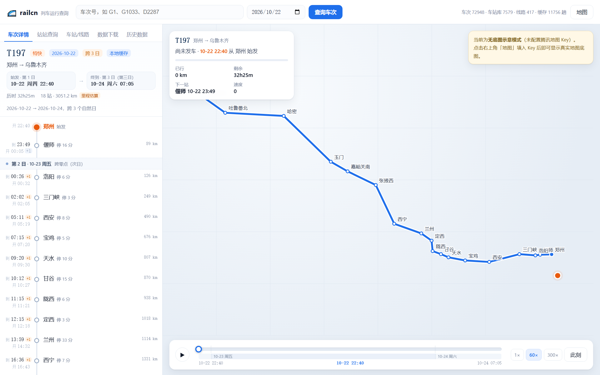
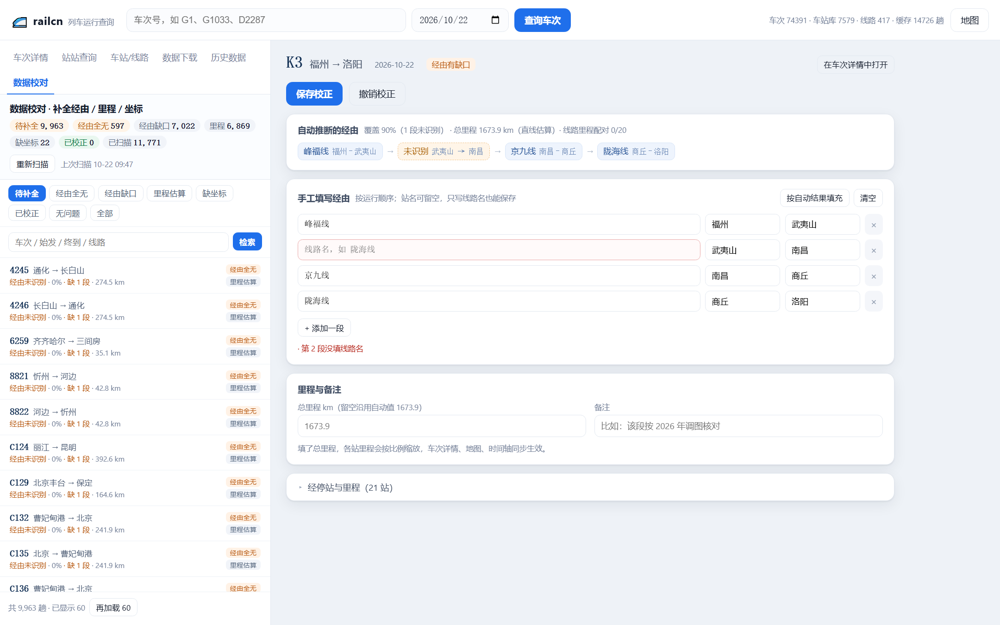
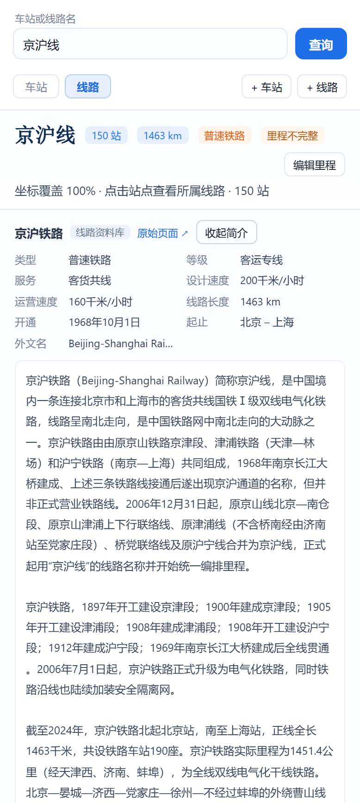

# railcn · 本地铁路数据工作台

把 12306 车次、铁路底表、线路资料库与 OSM 走向整合成一套**纯本地网页**：查车次时刻表、按日期批量落库、回看历史、在地图上还原走向与列车位置，并在「线路整理台」里把多套来源的线路人工整理成可全项目复用的规范线路。

零 Web 框架、零构建步骤、零数据库服务 —— Python 标准库 + SQLite + 原生 JS。

```
G1 北京南 → 上海虹桥
始发 · 第 1 日 10-22 周四 07:00  →  终到 · 第 1 日 10-22 周四 11:38
经停 7 站 · 1318 km · 经由 京沪高铁
```



<sub>长交路车次明确区分第 1/2/3 日，跨零点有分隔行与 `+1`/`+2` 角标。地图未配置 Key 时自动降级为无底图示意模式。</sub>

---

## 能做什么

| 模块 | 要点 |
|---|---|
| 车次详情 | 经停站时刻表（到 / 发 / 停留 / 里程）+ 地图走向；经由线路上的**通过站**也标出；跨线区间可串接；中途换号按铁路写法合并（`4355/8`）并标明换号站 |
| 时间轴 | 自绘时间条（不依赖原生 `range`），拖拽 / 点击 / 方向键；条上标出每站站名与时刻，点站名即跳转；倍速 1×~86400× 可自定义并记住 |
| 车站 / 线路 | **车站**模式查档案（路局 / 电报码 / 连接线路 / 坐标）；一个站在各套来源里有多个坐标时**全部列出**（来源 / 坐标系 / 距当前距离），可逐处「用这个」确认，也可照旧手填「补坐标」；**线路**模式只列「线路整理台完成全部确认」的线路：查询框**下方常驻列出全部确认线路**，按确认先后倒序（**最新确认在最上**，显示确认时间与站数 / 里程 / 起讫），输入线名即在其中即时筛选（含别名 / 走向来源名），点一行打开详情；自带完整停站 + 定位 + 真实走向，可手改站间里程与总里程；**点「编辑里程」切专用布局**：清单收成一行表头、重复站序隐藏，编辑区紧跟标题占住首屏（工具条吸顶、总里程在上、长说明可折叠），收起编辑自动还原 |
| 线路整理台 | 独立页面 `/linedesk.html`、独立库 `linedesk.db`：基本信息 → ① 只定走向 → ② 只定站点 + 站序（**新增车站可指定插到哪一站之后**、可反向重算里程）→ ③ 合并保存**即定为基本线路**，主站同步可查 |
| 全路网列车位置 | 独立页面 `/trainmap.html`：车次全集 × 停站模板 × 每日开行记录推算当前在途列车，标车次号与起讫站，支持车次号 / 车种 / 始发 / 终到 / 途经站 / 状态 / 视野 / 任意时刻回放查询。已整理线路贴真实走向（红线），其余停站间直线（橙虚线）。**位置是时刻表推算，不是 GPS** |
| 批量下载 | 含当日 15 天任选日期抓当天全部车次 + 经停站，断点续传、自适应限速、一键连跑、导出 JSON/CSV；停站不变时按趟只存一份内容，不重复占空间。**刷新全集默认同时搜「起始日 + 预售窗口最后一天」**，覆盖 2026-11-25 改号后只在切换日开行的 V/N/Z/Y 新字头（`docs/renumber-2026.md`）；下载面板可关掉第二个日期以省一半搜索请求 |
| 历史数据 | 任意已落库日期回看，按车次 / 始发 / 终到检索，只读本地库 |
| 数据校对 | 扫全库标出「经由认不全 / 里程只能估算 / 缺坐标」，逐段补线路名、改站间里程、改每站经纬度；**线路只认整理台确认的那几条**（来源版本不出现，认不出就是缺口）；**手工填经由时线路下拉默认只列「含本段发车站」的确认线路**（发车站 = 本段起点，空则上段终点，再空则车次始发；顶部有「显示全部线路」开关）；**右侧常驻线路走向 / 停站图**：点任一线路框或搜线名即显示该线真实走向、全部停站与本趟车停站叠加，有腾讯地图 Key 显示底图、没 Key 用可缩放拖拽的示意 Canvas；**线路 / 车站以后增加会自动跟上**（候选按本趟车站点动态算，不缓存全库名单）；**自动推断的经由要确认才进正式库**；同起讫点车次列停站详情后人工勾选同步 |
| 备份线路 | `/backup.html` 扫历史备份全列出，可看站序与走向，**点「导回来」才写库** |
| 走向编辑器 | `/osmedit.html` 腾讯地图底图（Key 存本机、代码不含；没 Key 的离线自绘模式同样可编辑）：**所有有走向的线路都能搜到**（4500+ 条，滚动加载）、默认只画走向不画站点；**整理台已确认线路全部列入、线名标红并排在最前**，改完应用会写回整理台 `ld_geom` 且**仍是已确认线路**；点红点选中即可拖 / 删，添加点模式点空白处加点（**新建 / 刚起画时按点序往后接，第 3 点接在第 2 点后面**；编辑已有走向才按最近线段插）；也可**从空白画一条新线**——依次落点 → 沿线抓站 → 建线入库 |



<sub>校对页把自动推断的经由按区间展开，认不出的缺口直接列候选线路；每段点一下即可收进手工列表。改完线路库可一键重算自动经由。</sub>

---

## 五个页面

| 地址 | 用途 |
|---|---|
| `/` | 主站：车次详情、车站 / 线路、数据下载、历史数据、数据校对 |
| `/linedesk.html` | 线路整理台：归并来源、确认走向与站点、定基本线路 |
| `/trainmap.html` | 全路网列车位置与行车路线 |
| `/backup.html` | 备份线路浏览与按需导回 |
| `/osmedit.html` | 走向编辑器：全量有走向线路任选 + 整理台已确认线路红名置顶（改完仍是确认线路），改走向（拖 / 加 / 删点，离线可编辑），或画一条新线并建线入库 |

---

## 快速开始

```bash
pip install -r requirements.txt          # 服务本体只用标准库；网络请求需要 requests
python webapp/server.py --port 8686      # Windows 也可双击 webapp/start.bat
```

打开 <http://127.0.0.1:8686/>。

- **改了 `.py` 必须重启服务**（常驻进程无热重载）；只改 `webapp/static/` 刷新页面即可。
- **地图**：填自己的腾讯位置服务 Key（页面右上角，存 `localStorage`，不写进代码）；没有 Key 自动降级为离线自绘 Canvas 示意模式，功能不减只是没有底图。新页面一律用腾讯地图，WGS-84 坐标按 GCJ-02 纠偏。
- **数据**：`webapp/data/rail.db` 运行时自动创建；`webapp/data/linedesk.db` 是人工整理成果，随仓库保存。

---

## 线路整理台：当前流程（2026-11-06 定稿）

整理台是**全项目线路数据的唯一入口**。步骤如下，**④「定为基本线路」已取消**：

```
基本信息  →  ① 线路来源  →  ② 站点来源  →  站序（可反向）  →  ③ 合并保存
  正式落库     只定走向       只定站点+定位      倒排重排里程      ①② 合并 = 基本线路
```

| 步骤 | 只做什么 | 明确不做什么 |
|---|---|---|
| 基本信息 | 保存规范名 / 起讫 / 类型，返回保存时间 | 不自动套资料库名称 |
| ① 线路来源 | 确认这条线用哪一家的 **OSM 走向**，只写 `src_line`/`line_ok`；也可「导入走向」 | **不碰停站、不写 `ld_geom`、不改基本信息** |
| ② 站点来源 | 确认**全部车站与定位**，只写 `ld_stop`/`stop_ok`；也可「导入站点」 | **不保存 OSM 路线、不写 `ld_geom`** |
| 站序 | 调站序；**「+ 站」可指定插入位置**（最前面 / 第 N 站之后，一次可填多个站名按顺序插入）；「反向站序」按 `原末站里程 − 原里程` 倒排重排，新起点 0，缺的不插值 | 新站里程留空、不自动插值；换方向不会取消 ② 的确认 |
| ③ 合并保存 | 合并 ① 走向 + ② 站点，**同时定为基本线路**（写 `line_base`），主站「车站/线路」立即可查 | 不再有独立的 ④，也不再二次配置走向 |

- 两个 GeoJSON 导入入口**互斥**：`only='geom'` 只给 ① 用，`only='stops'` 只给 ② 用。
- ③ 的自动发布放在 `/api/ld/finalize` 的 HTTP 编排层，不塞进 `linedesk.finalize()`，避免回归脚本往正式库写脏数据。
- 走向折线点序一律 `[lon,lat]`：③ 写入时归一、读取时优先原始多段并纠正历史反序主轴（反序会让地图左上角多出一条竖线）。见 `test_geom_axis.py`。
- 已定稿的线 ③ 按钮变「重新合并保存（覆盖基本线路）」；③ 区块右上角保留「撤销基本线路」。
- 规范名带「（来源）」后缀时 ③ 会被后端拦下，先在基本信息里改正名。


<sub>主站线路模式**只认完成全部确认的线路**，其它线路、来源版本、OSM / 资料库 / 备份候选、选线入口、★ 设默认一律不显示；查一条没确认的线只给「去整理台完成确认」的提示，不拿资料库或 OSM 兜底。清单和站数跟着整理台走、不写死，实时清单见 `/api/line/confirmed?full=1`：下方常驻全量清单按 `ld_log` 的 `finalize/publish` 确认时间倒序（最新在上，老数据回退 `updated_at`），输入即在其中本地筛选，不再另弹联想下拉；清单可收起，打开线路详情也不会消失。进入「编辑里程」时清单临时折成表头、站序列表隐藏，把首屏让给编辑区，收起编辑即恢复，用户自己设的收起/展开状态不变。</sub>

---

## 数据来源与库

| 来源 | 用途 |
|---|---|
| 12306 | 车次清单、经停站、余票（低频调用，仅学习研究） |
| `cnrail_data_v2.xlsx` | 车站档案、线路站序、累计里程底表 |
| 辉睿「中国铁路线路一览」 | 844 条线路的技术参数、简介、逐站里程；**中文名称 = 线路正式名称** |
| china-emu | 逐站 K 里程补充 |
| OSM / HOT 中国铁路导出 | 线路几何、第六套站序来源、车站坐标 |

两个库各司其职：

- `webapp/data/rail.db` —— 车次 / 经停 / 校正 / 坐标 / 线路与走向。核心表：`trains`、`train_universe`（车次全集物化，让下载页秒开）、`route_tpl` + `route_day`（经停站按趟去重）、`day_skip`（**「当时未查到」非终态**，带复核期限）、`line_custom`、`line_base` + `line_base_stop`、`line_geom`、`station_master`（多源车站合并，来源只进备注）、`train_override`（人工校正正式库）、`coord_override`、`line_override`。
- `webapp/data/linedesk.db` —— 整理台独立库：`ld_line` / `ld_alias` / `ld_stop` / `ld_geom` / `ld_relation` / `ld_ref` / `ld_log`。**整理过程不改 `rail.db`**，只有 ③ 发布基本线路时写入。

数据口径上两条硬规则：**站名统一不带「站」**（`杭州东站` 与 `杭州东` 同一站，「十八站」这类真名保留）；**所有来源的车站名称不带来源后缀**，来源信息只放 `note` / `sources` / `aliases`。



<sub>线路详情给出技术参数、简介与原始页面链接；档案里程与资料库对不上时列出差值最大的站，可一键按资料库锚点重算，也可随时恢复档案。</sub>

---

## 目录结构

```
railcn/
├─ config.py / trainclaw.py          12306 客户端与字段常量（来自 TrainClaw）
├─ collect_trains_p2.py              批量采集车次清单
├─ collect_routes.py                 批量采集经停站
├─ cnrail_data_v2.xlsx               车站 / 线路 / 站序原始底表
├─ data/                            cnrail JSON、线路资料库、chinaemu、osm、crtrain 几何
├─ scripts/                         数据导入 / 归一 / 合并脚本 + 53 个回归脚本
├─ tools/                           Excel → JSON、坐标反解等一次性工具
├─ docs/                            截图、工作底稿、便携版说明、旧版归档 archive/
└─ webapp/
   ├─ server.py                     全部 HTTP 路由（标准库 ThreadingHTTPServer）
   ├─ railcore.py / cnrail.py       缓存、坐标、经由推断、里程、校正存取
   ├─ curate.py / collector.py      数据校对 / 按日期批量下载
   ├─ historyq.py / routestore.py   历史查询 / 经停站按趟去重
   ├─ linedesk.py / confirmed.py    整理台独立库 / 确认线路白名单（只读 linedesk.db）
   ├─ linebase.py / linegroup.py    基本线路 / 来源版本归组
   ├─ lineseg.py / railosm.py       分段线与走向互补 / OSM 真实走向
   ├─ railgeom.py / geoimport.py    几何按名索引 / GeoJSON 图论建线
   ├─ backup_lines.py               备份线路浏览与按需导回
   ├─ trainmap.py / traintrack.py   列车位置内存索引 / 行车路线贴线
   ├─ data/                         rail.db、linedesk.db、station_coords.json
   └─ static/                       index / linedesk / trainmap / backup 四个页面
```

完整数据模型、接口表与业务规则见 [`docs/PROJECT-CONTEXT.md`](docs/PROJECT-CONTEXT.md)，功能与接口细节见 [`webapp/README.md`](webapp/README.md)。

---

## 走向编辑器：改走向 / 新建线路

`/osmedit.html` 用腾讯地图做底图（Key 存本机 `localStorage['railcn.mapkey']`，代码不含 Key）；没 Key 时降级为**离线自绘 Canvas**（不画国界），**加 / 拖 / 删点照常可用**。

- **列表 = 真有走向的线 + 整理台已确认线路**：`line_geom` / `line_route` / `ld_geom` / 编辑器草稿 / OSM 线名全量去重（当前 4513 条），一次 100 条、滚到底自动续；整理台里没走向的几千条草稿不再混进来。非确认的借走向线（`geom_name ≠ 规范名`）也列得出，应用时写回被借的那份几何。
- **整理台已确认线路（线名标红、排最前）**：`confirmed.recent()` 全量（当前 21 条）打 `confirmed` 标记，加「已确认」红标签，按线名或走向来源名都能搜到。载入一律用**规范名**走 `lineosm.geom(..., confirmed_only=True)`，也就是主站 `/api/line/osm` 正在显示的那份多段走向，草稿也按规范名读写。点「应用到线路库」写回 `linedesk.db / ld_geom`（按 `line_id` 绑定，原本没有就插一份，等于把借来的走向固化到自己名下），主站「车站/线路」立刻生效；**`ld_line` 的 status / line_ok / stop_ok / geom_src / geom_name / 确认时间全不动 → 保存后仍是整理台已确认线路**。
- **载入 = 主站同一份多段走向**：主站 `/api/line/osm` 与编辑器共用 `webapp/lineosm.py`（确认线路 → `confirmed.geom()`；其余依次基本线路 `ld_geom` → 来源包 → GeoJSON → OSM → 分段线借几何）。编辑器**按段抽稀、按段绘制、按段保存**，段与段之间不连线；不再读 `ld_geom.spine_gz`（抽稀 + 补断口主轴，画地图会失真），也不再把多段硬串成一条折线 —— 以前那样会让滨绥线 902 km 只剩 13 km、沪昆线冒出 274 km 假直线。抽稀默认 600 点，每段至少留首尾两点，段内 >25 km 的空隙会补回中间点。
- **改已有线路**：左侧搜线路 → 载入主站那份多段走向（默认 600 点，可拖动「抽稀精度」重载）→ 点红点选中（变蓝）后拖动改走向，或「删除选中点」/ Delete 键 / 右键删；「添加点模式」点空白处插点（折线至少留 2 点；**新建 / 刚起画时按点序接在末尾**，第 3 点不会插回第 1、2 点之间；载入已有走向后按最近线段插，点线尾延长线也往后接），Ctrl/⌘+Z 撤销。插点 / 删点 / 撤销都会维护断点，不会把两段接成假直线。站点参考点默认隐藏、可勾选显示 →「保存到草稿」（只存 `line_geom_edit`，不动原库）或「应用到线路库」（写回 `ld_geom` + `line_geom`，地图才真变）。
- **连接两点 / 接着末尾画**：多段走向的段与段之间本就不连线，想把两个**已有的点**直接连起来，点「⇄ 连接两点」后依次点两个红点（或按住 Shift 点两个红点，Esc 退出）：两点正好卡在断点两侧就把两段合成一段，其余情况补一条两点直线段，原折线一点不动；再点同一对可断开，Ctrl/⌘+Z 也能撤。连线段端点引用原顶点，拖点会跟着走，保存后作为独立一段写进 `parts`。载入已有线路后想按点序继续往后画，点「↳ 接着末尾画」显式切回追加模式（**默认仍是插点**，避免误把点插进中间又画成回折）。
- **新建线路**：填线名 →「＋ 新建」→ 地图上依次落点画出走向 →「沿线抓站」按**原始轨道**认站并按沿线里程排序（可勾掉不要的站、按名字补站）→「建线入库」。
  建线**不另开写库路径**，一律组装成 GeoJSON 走 `geoimport.import_line`（raw 通道：以画出的走向为准算里程、站名不归一），库里已有同名线会提示，自建线可勾覆盖。
- 抓站量距离用的是这条线的**原始碎段**（不串线）：串线是 O(段数²)，陇海线要 60s，抓站没必要付这个代价。

---

## 车站多坐标：列出 / 确认 / 手填

`station_master` 是 17 套来源合并成的一个规范实体，只挑了一个坐标生效，其余只在备注里留一句「同名 N 处坐标，最远相距 X km」—— 看得见有分歧、看不到分歧在哪。现在把每一套来源的每个坐标都建成 `rail.db / station_coord_cand`（`webapp/stationcoords.py`，`python webapp/stationcoords.py --force` 可重建），车站卡片里：

- 相差 60 m 以内的并成「一处」，列出认同这个点的来源、原始坐标系、距当前生效坐标多远；当前生效的那处标绿。
- 顶部橙标签提示「多坐标 N 处 · 最远 X km」，同名不同地点（如东莞西有一个 12.7 km 外的 TrainVis 点）不会被抹掉。
- 点「用这个」＝ 把该坐标写进项目原有的人工坐标通道 `coord_override`（记下确认来源，卡片显示「已确认自 XX」），可「撤销人工」还原；原「补坐标」手填入口不变。
- 六源 CSV 的坐标系备注说的是**原始仓库**，值已被上游不同程度归一；按标签盲换会造出假坐标。`coordcrs.calibrate()` 用同名站的 WGS84 基准点自动挑「原样 / GCJ→WGS / BD→WGS」，同名不同地点的原样保留。
- 独立接口 `GET /api/station/coords?q=站名`；车站卡片的数据随 `/api/station` 一起返回（`coordCandidates`）。

## 回归与开发约定

```bash
# 逐个跑，不要并发（并发会留下孤儿 override）
"C:/Users/Administrator/AppData/Local/Programs/Python/Python313/python.exe" scripts/test_ld_flow.py
```

`scripts/test_*.py` 共 **53 个**，覆盖 GeoJSON 建线、走向点序（`test_geom_axis`）、**2026 改号新车次能被枚举并下载（`test_renum_enum`）**、**车种标签按日期分时代 + 勾阶段自动重扫（`test_trainclass_labels`）**、走向编辑器建线（`test_osmedit`）、**载入形状与主站多段几何一致（`test_osmedit_multipart`）**、**走向编辑器里整理台已确认线路红名 / 专属载入 / 写回后仍是确认线路（`test_osmedit_confirmed`）**、车站多坐标与确认（`test_station_coords`）、整理台三步流程与「站序删改后确认不回灌」（`test_ld_stop_confirm`）、**新增车站指定插入位置（`test_ld_insert_stop`）**、**线路模式下方全量确认清单与按确认先后倒序（`test_confirmed_list`）**、**编辑里程首屏版面与还原（`test_km_editor_layout`）**、定稿走向跟到主站（`test_ld_publish_geom`）、确认线路白名单、**校对只用整理台确认线路（`test_curate_confirmed_scope`）**、**车次详情两种走向（`test_route_geo`）**、**跨线经由链与 N1534 和硕—吐鲁番—大河沿走向（`test_route_via_chain`）**、**校对按发车站筛线路 + 页面内走向图 + 新增线路/车站自动跟上（`test_curate_linefilter_map`）**、基本线路、里程编辑、站名归一、数据校对接、连跑与 `day_skip` 复核、列车地图与贴线等。清单与每个脚本守什么见底稿第 7 节。注意：部分脚本失败时退出码仍是 0，要看输出里的「失败 N 项」；跑完检查 `station_custom` / `line_override` 有没有测试残留。

**当前约定**：代码与库的改动只留本地，**提交 / push 暂停**，U 盘同步也暂停，等明确说「需要提交」再执行。

---

## 文档地图

| 文档 | 内容 |
|---|---|
| `README.md`（本文件） | 功能全貌、快速开始、当前整理台流程、目录结构 |
| [`docs/PROJECT-CONTEXT.md`](docs/PROJECT-CONTEXT.md) | 工作底稿：数据模型、不能改的业务规则、坑、回归清单、待办 |
| [`webapp/README.md`](webapp/README.md) | 技术参考：数据来源、模块职责、HTTP 接口、前端约定 |
| [`docs/PORTABLE.md`](docs/PORTABLE.md) | 便携版（免盘符 Python）部署 |
| `docs/archive/` | **2026-11-06 重写前的全部旧版文档与记忆日志**，另有 `railcn-docs-20261106.zip` 打包副本；历史细节以旧版为准 |

---

## 免责声明

- 车次、经停站、票价与余票数据版权归**中国铁路 12306** 所有。本项目仅调用其公开接口做个人学习与研究，请低频访问、勿用于商业用途或大规模抓取。
- 地图与车站坐标来自 **© OpenStreetMap contributors**（ODbL），经 HOT 中国铁路导出整理。
- 线路技术参数与简介来自 [辉睿软件 · 中国铁路线路一览](https://tool.huiruisoft.com/train/railway/index.html)，界面保留「原始页面」链接，版权归原站所有。
- 余票、票价、列车位置（时刻表推算）仅供参考，以 12306 官方为准。

## 许可

[Apache License 2.0](LICENSE)。本项目包含来自 [TrainClaw](https://github.com/AI4MSE/TrainClaw)（Apache-2.0）的代码，署名见 [NOTICE](NOTICE)。
