# railcn · 12306 车次行程可视化

把 12306 的车次与经停站数据做成一个**纯本地网页**：输入车次就能看完整时刻表，在地图上沿真实铁路线还原列车此刻跑到哪了，还能按日期把当天所有车次批量落库、随时回看。

零 Web 框架、零构建步骤、零数据库服务 —— 只有 Python 标准库 + SQLite + 原生 JS。

```
G1 北京南 → 上海虹桥
始发 · 第 1 日 10-22 周四 07:00  →  终到 · 第 1 日 10-22 周四 11:38
经停 7 站 · 1318 km · 经由 京沪高铁
```

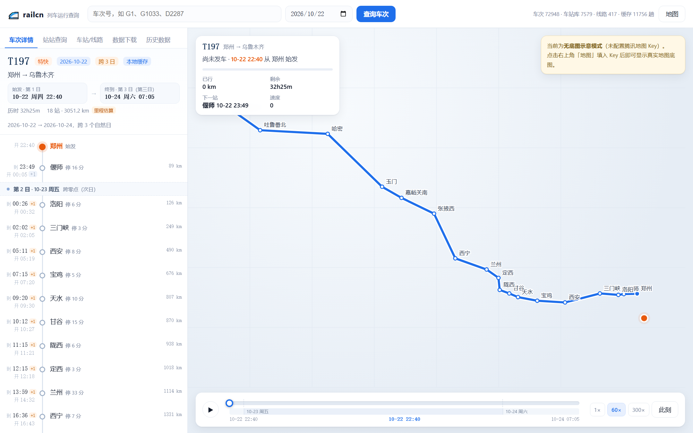

<sub>T197 郑州 → 乌鲁木齐，跨 3 个自然日；当日跨零点处有分隔行，时刻旁 `+1` 角标。此图未配置腾讯地图 Key，地图为自动降级的示意模式。</sub>

## 它能做什么

| 模块 | 说明 |
|---|---|
| 车次详情 | 输入车次回车，出经停站时刻表（到/发/停留/里程），地图同步画出线路；**经由线路上的通过站（不办客）也一并标出**，人工校正过的经由按线路库站序展开，跨线区间（如济南枢纽那种要中转线路的）也能串起来 |
| 跨日显示 | 长交路车次明确区分第 1/2/3 日：行程带、跨零点分隔行、时刻旁 `+1`/`+2` 角标 |
| 列车位置 | 按时刻表把「运行时长」换算成绝对时间，在站间按里程插值定位，带 HUD 显示下一站与剩余时间 |
| 地图路线 | 车次详情的路线默认是「沿途车站连成的折线」；点「按真实走向」可换成用 OSM 线路几何拼出来的走向，拼不上的路段按沿途通过站补，并告诉你几处缺口、多少公里是这样补的 |
| 时间轴 | 自绘时间条（不依赖原生 `range`），可拖拽/点击/方向键；**条上直接标出每一停站的站名与时刻**，点站名即跳到那一刻，站挤时自动错层；倍速 1× / 60× 直接切，**其余倍速自己填**（预设 120× ~ 14400×，任意值到 86400×，即 1 秒走完 1 天），并记住上次用的倍速 |
| 站站查询 | 输入起终站查实时余票（席别 / 票价 / 余票数），点一行直接跳到该车次行程 |
| 车站 / 线路 | 7579 个车站档案、500 余条线路的途经站序与累计里程，可互相跳转；选中线路后**站间里程与线路总里程都能手改**，档案里缺的段显示 `-`；**档案里没有的线路 / 车站可以自己新增**。站名联想带去「站」字也能搜（`唐海南站`），档案里没收录的站（唐海南、曹妃甸港这类货运支线上的站）用 12306 站表兜底，照样能查、能补坐标、能看当天经停车次；**OSM 里有、线路库没收录的线会一并列出**（搜「津霸」时，除了库里的「津霸客运专线」，还有普速的「津霸线」），点开看走向、补站就能收进线路库 |
| 线路资料 | 每条线路都带**技术参数与简介**（类型 / 等级 / 服务 / 设计速度 / 运营速度 / 长度 / 开通日期 / 起止站点 / 外文名 / 别名 + 正文介绍，注明原始页面）；档案里程与资料库对不上时给出比对并支持**一键按资料库里程重算**；线路库没有的线路可在资料库里查到、只读预览站表，也能一条命令收进线路库 |
| 批量下载 | 选日期批量抓当天**全部车次 + 经停站**，断点续传、自适应限速、导出 JSON/CSV |
| 历史数据 | 已落库的任意日期都能翻，按车次/始发/终到检索，只读本地库不打扰 12306 |
| 数据校对 | 扫全库标出「经由认不全 / 里程只能估算 / 缺坐标」，逐条补全：**线路下拉选**、**站间里程逐段改**、**每趟车所有经停站都能改经纬度**（含档案里已有但可能出错的），人工值优先于自动推断，随改随生效；**同起讫站、同车种的车次只填一趟，其余自动沿用**；自动链上的段**点一下就能收进手工列表**，认不出的缺口直接列候选线路点选；改完线路库点「重算自动经由」即按新线路重推 |

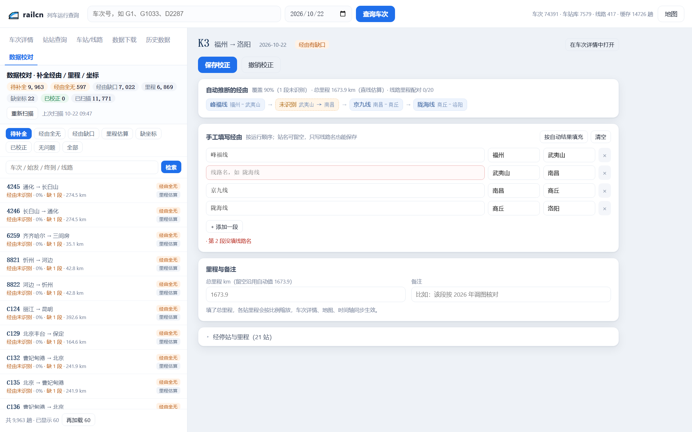

<sub>「数据校对」页：自动推断的经由按区间展示，中间认不出的那一段直接留在链路里（而不是被吞掉）；每一段点一下就收进下面的手工列表（变绿带勾），缺口处直接列候选线路（缺口前后同线的最先）；右侧逐段补线路名、改总里程，保存前会校验区间首尾相接。</sub>

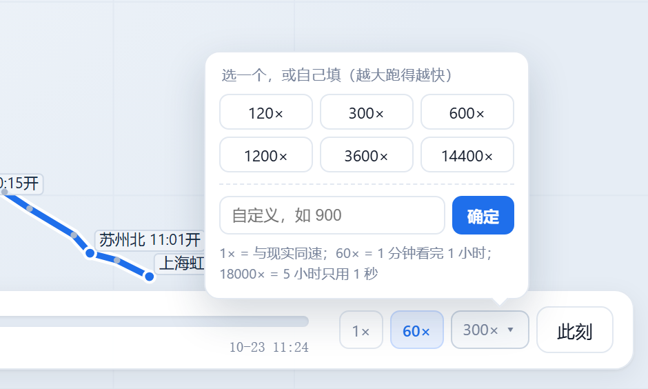

<sub>底部时间轴右侧的 `300× ▾` 是倍速入口：常用 120× ~ 14400× 一键选，也可以在输入框里填任意值。</sub>


<sub>时间条上每一停站都有一个小圆点，下面写站名与时刻（首站发车、中间站到达）。站距太近时自动错到下一层，首末站一定保留标签；实在放不下的站只留圆点，悬停能看「到 / 开 / 停几分钟」。点任一站名，列车和游标一起跳过去。站多嫌挡地图就点「停站」关掉，选择会记住。</sub>

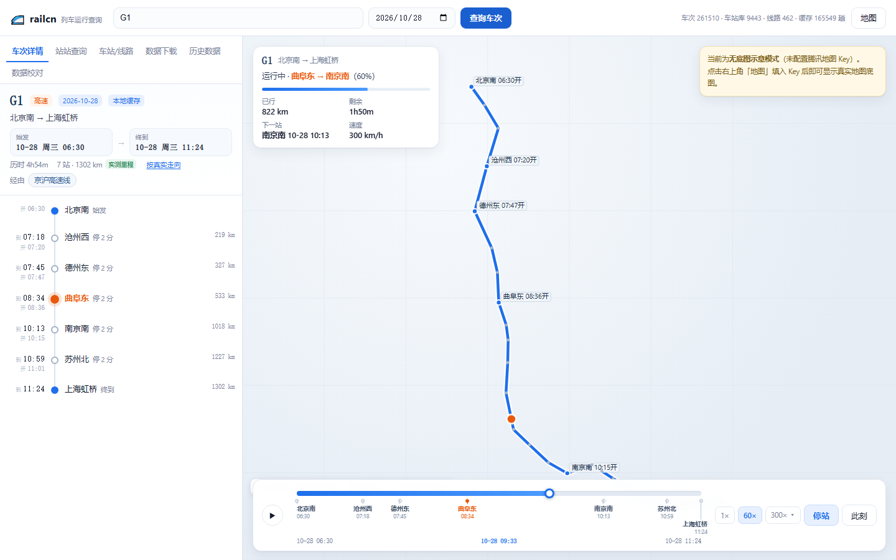

<sub>车次详情的默认画法：把沿途车站（含不办客的通过站）连成折线。站距大时这一段就是一根直线 —— 京沪这种干线还看得过去，跨线车次会明显「抄近道」。</sub>

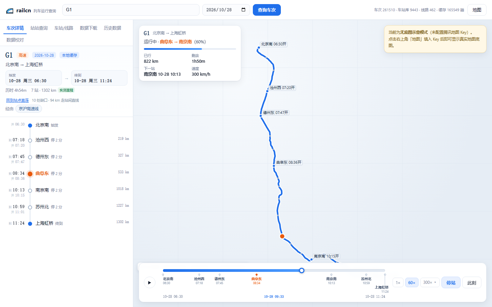

<sub>点侧栏的「按真实走向」，同一趟车换成 OSM 线路几何拼出来的走向：每个几何段的两端投到车次折线上算里程，一段段拼起来，复线上下行只留一条。拼不出来的路段只能用直线跳过去，按钮旁边会写清楚「几处缺口、多少公里是直线」，免得把直线当成了真实走向。</sub>

> 这份 OSM 几何是按线名切碎的（`data/crtrain/geoms.json.gz`），所以**干线车次贴合得很好**（G1 京沪 1302 km 只有 94 km 靠直线），**跨线/普速车次缺口多**（D2290 深圳北→南通有 660 km 要按沿途通过站一站一站直连补）。想知道某条线本身长什么样，从车次的经由线路名点进去看更准；缺口只影响画得像不像，里程、时刻、列车位置都不受影响。

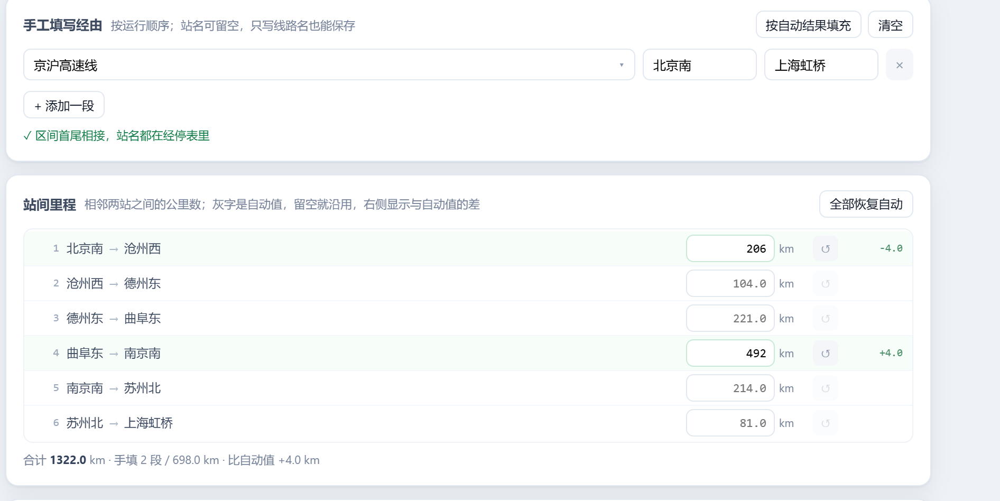

<sub>站间里程逐段可改：灰字是自动值，填了就锁住这一段，行尾显示与自动值的差；合计与各站累计里程随输入实时重算。</sub>

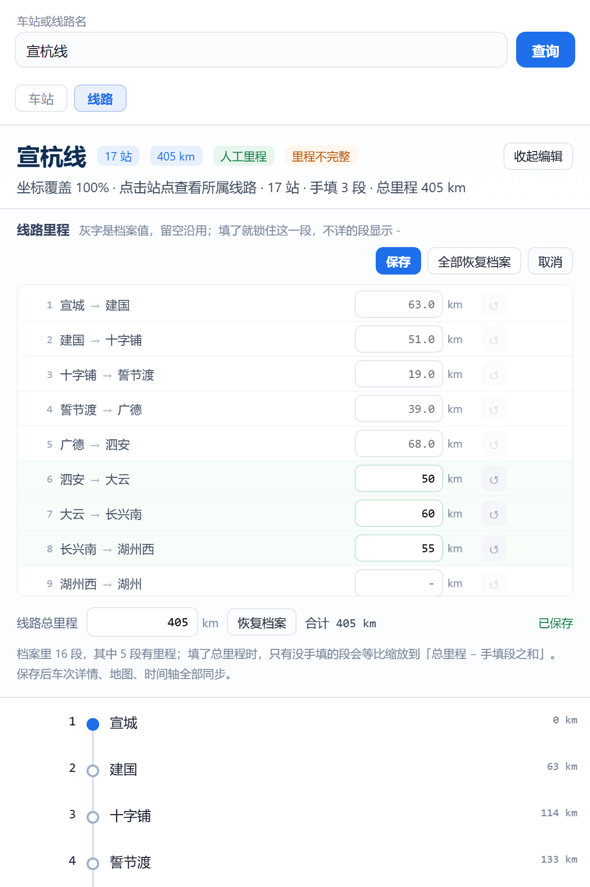

<sub>「车站 / 线路」里选中一条线，点「编辑里程」就能改这条线的里程：按相邻两站逐段填，档案缺的段灰字是 `-`（表示不详），填完即锁；总里程与手填段可以同时给，未手填的段按比例缩放到「总里程 − 手填段之和」。保存后这条线的里程立刻参与车次里程计算。</sub>

里程有两种填法，右上角一键切换：**按段距**填相邻两站之间的公里数，或**按累计**直接填「从起点站到这一站」的公里数 —— 后者更贴近手头铁路里程表的口径。两种数据分开存：段距存区间，累计直接钉在站上，互不覆盖；哪一格填了就以填的为准。

两边的 `-` 含义不同，也是各自最自然的读法：**按段距**时 `-` 表示「这一段站间距不详」，**按累计**时 `-` 表示「这一站的里程不详」。不论哪种，不详都只影响它自己，后面的车站照常用档案里程续上，不会一条线全废。

标了 `-` 的行尾会出现一个「≈」：用两站经纬度算直线距离、乘 1.25 的曲折系数，点一下就能填进输入框/累计算式里当参考（两站缺坐标时不显示）。另外，输入框里有非法值时保存会被挡住并提示「有 N 处输入不合法」，不会出现"点了保存、其实没存上"。

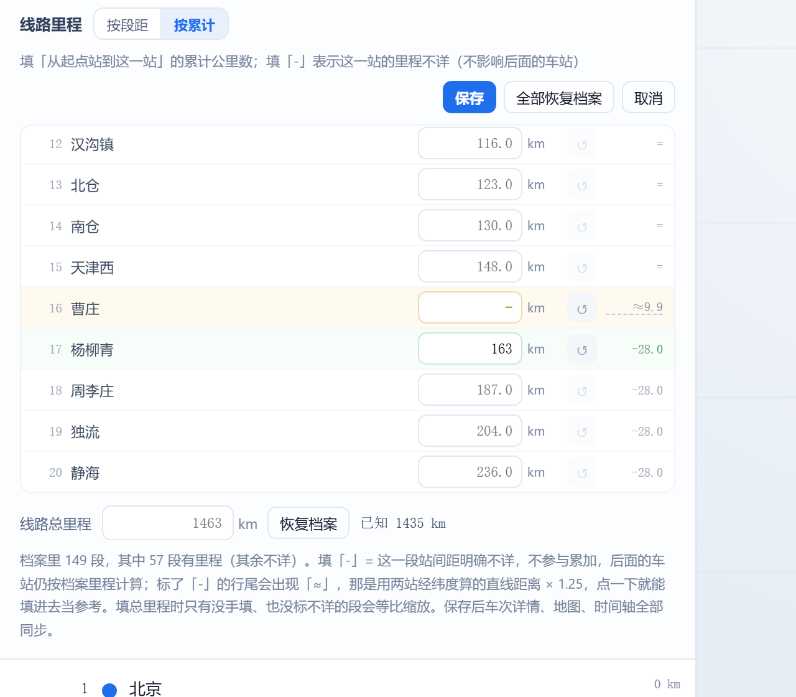

<sub>按累计填的样子：曹庄填 `-`（这一站里程不详，行尾给一个按经纬度估的 `≈9.9`），杨柳青填 163，后面几站按档案段距顺延；填得比前一站还小时保存直接被拦住，按钮转红。</sub>

### 线路资料库（参数 / 简介 / 里程锚点）

线路库原来只有「站序 + 里程」，没有线路本身的资料。现在从[「中国铁路线路一览」](https://tool.huiruisoft.com/train/railway/index.html) 抓了一份线路资料库并整合进来：

| | 数量 |
|---|---|
| 资料条目 | 844 条线路（10377 个站点行，其中 5420 个带里程，844 条都有介绍正文） |
| 挂到线路库现有线路 | 385 / 461 条（84%），详情页直接出参数与简介 |
| 补进线路库的新线路 | 42 条（车站坐标覆盖 ≥80%、站点 ≥4，能直接画线、参与经由推断） |
| 只有资料、未入库 | 其余条目可以在搜索时查到，只读看站表，点「收进线路库」随时补 |

匹配不是只看名字：先认同名，再认同族（`沪宁城际铁路` ↔ `沪宁城际线`、`石太高铁` ↔ `石太客运专线`），最后按**站序重叠率**挂靠，且高速/普速口径必须一致 —— 否则 `京沪高铁` 会被错挂到 `京沪线`。

顺带发现了档案里程的问题：一部分线路的里程是「按站数摊」出来的。京沪线泰山档案写 1463 km（等于全线长度），铁路里程表是 555.8 km；沧州档案 445 km，实际 251.2 km。所以两边比对出偏差时，详情页会：

1. 明确列出「档案 / 资料库」的差值最大的几个站（比如 `泰山 1463 / 555.8`）；
2. 给一个**「按资料库里程重算」**：以资料库的 24 个里程锚点为骨，锚点之间按站间直线距离线性插值，首尾按相邻区间的比例外推，算完写成人工校正（`line_override.sta_km_json`）；
3. 不满意就「全部恢复档案」，随时撤回。

口径本来就一致的线路，会在加载时补上档案里空着的站里程（只补 `null`、不改已有值，补完还要过单调校验，所以真正能补的很少 —— 大头还是靠上面的「重算」）；口径不一致的线路一律不动，等你定夺。

重新生成（抓取有本地缓存，重复执行只补缺的页面）：

```bash
python scripts/fetch_huirui.py                                  # 抓 844 个页面 → data/huirui/lines.json
python scripts/import_huirui.py                                 # 只出报告：匹配率 / 里程口径 / 可补线路
python scripts/import_huirui.py --apply --add-lines 0.8         # 写库（会先备份 rail.db）并补线路
```


<sub>线路详情顶部的资料卡：技术参数一览 + 可折叠的简介正文 + 原始页面链接；下面那条琥珀色提示就是「档案里程与资料库对不上」，右边可以直接按资料库重算。</sub>


<sub>线路库里没有的线路：搜索时会列出资料库里的条目，点开是只读资料页（参数 / 简介 / 站表，有坐标的站顺便画到地图上），右上角「收进线路库」一步建成正式线路。</sub>

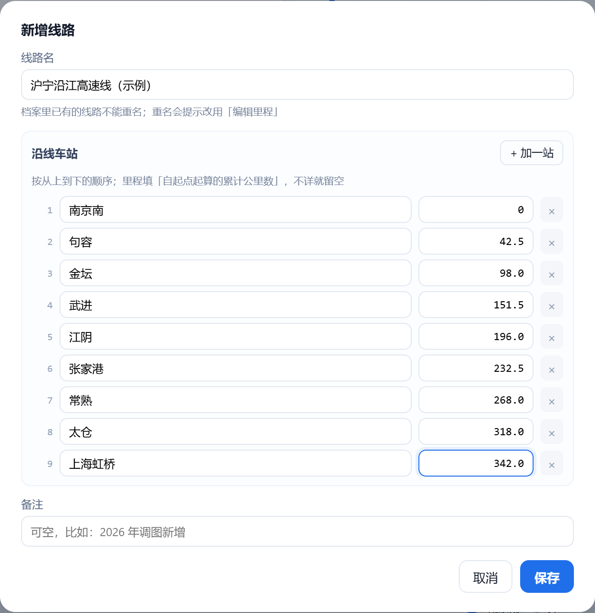

<sub>「车站 / 线路」右上角「+ 线路」「+ 车站」：档案里查不到的线路/车站直接补。新增线路只填线路名和沿线站序，每站可选填「自起点累计公里数」（不详就留空，界面上显示 `-`）；新增车站填站名与经纬度（支持直接粘贴「经度,纬度」）。新增后立刻参与车次里程计算与地图绘制，自建的条目带「自建」标记、可二次确认删除。</sub>

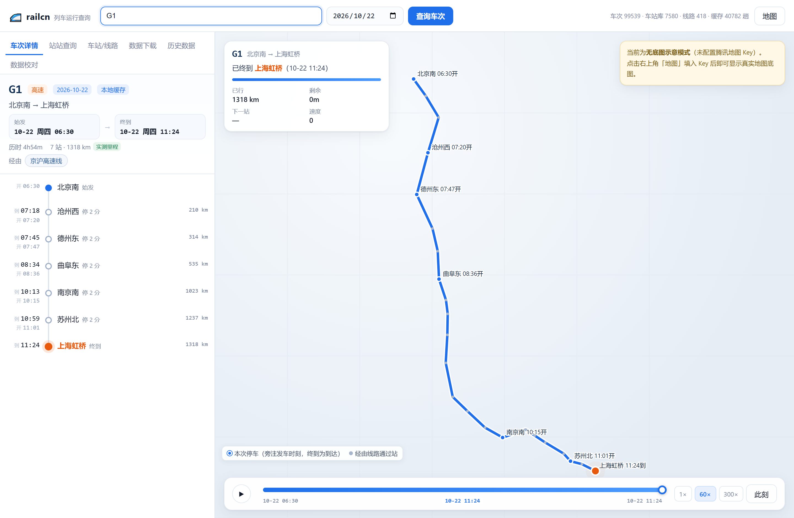

<sub>车次详情的地图：沿经由铁路线把**线路上所有车站**都画出来 —— 实心蓝点＝本次列车停车站，旁边注明发车时刻（终到站注明到达时刻）；浅灰小点＝该线路上列车通过但不办客的中间站。线路所、中继站这类非车站不上图。</sub>

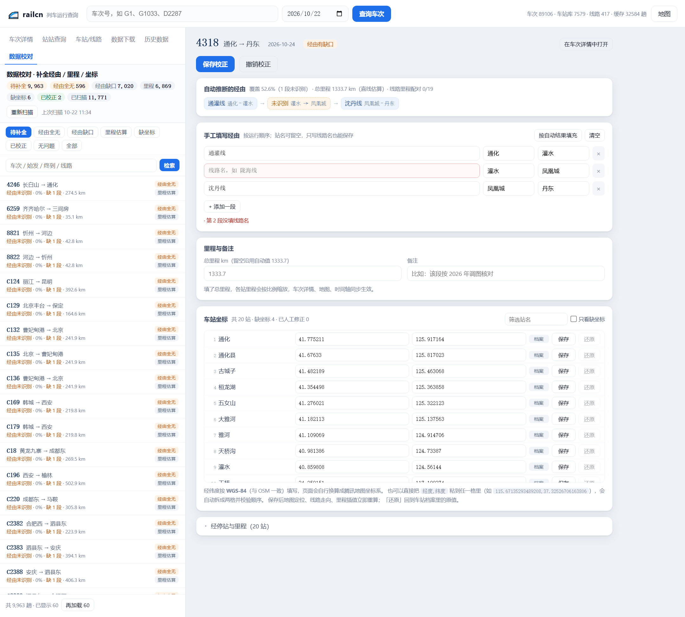

<sub>车站坐标卡片列出该车全部经停站：来源徽标区分「档案 / 人工 / 缺失」，缺失行红底标出；改完立即失效坐标缓存并重算引用该站的车次，地图定位与线路走向同步更新。</sub>

## 快速开始

```bash
# 1. 依赖（服务本体只用标准库，网络请求需要 requests）
pip install -r requirements.txt

# 2. 启动
cd webapp
python server.py --port 8686 --open
```

Windows 也可以直接双击 `webapp\start.bat`。

打开 <http://127.0.0.1:8686/>，默认会加载一趟标杆车。

> **地图**：带 Key 时用腾讯位置服务渲染，没有 Key 自动降级为 SVG 示意地图（功能不减，只是没有底图）。
> Key 填在页面右上角「地图 Key」，存在浏览器 `localStorage`，不会写进代码。

## 目录结构

```
railcn/
├─ config.py                  API 常量 / 字段索引（来自 TrainClaw，原样复用）
├─ trainclaw.py               12306 客户端 + 经停站解析（来自 TrainClaw）
├─ collect_trains_p2.py       批量采集车次清单（两阶段前缀搜索）
├─ collect_routes.py          批量采集经停站
├─ cnrail_data_v2.xlsx        车站 / 线路 / 线路站序 原始底表
├─ data/
│   ├─ cnrail_stations.json   7579 个车站档案（路局 / 电报码 / 连接线路 / 坐标）
│   ├─ cnrail_lines.json      417 条线路（途经站序 + 累计里程 + 可信标记）
│   ├─ cnrail_index.json      极简坐标索引 {站名: [lat, lon]}
│   ├─ cnrail_meta.json       生成参数 / 坐标修正模型 / 统计
│   └─ huirui/lines.json      线路资料库：844 条线路的参数 / 简介 / 逐站里程
├─ scripts/
│   ├─ fetch_huirui.py        抓「中国铁路线路一览」，解析成 data/huirui/lines.json
│   └─ import_huirui.py       把线路资料库写进 rail.db，并补全线路库里没有的线路
├─ tools/
│   └─ xlsx_to_json.py        Excel → 上面四个 JSON（含坐标反解与里程校验）
└─ webapp/
    ├─ server.py              本地 HTTP 服务（标准库 ThreadingHTTPServer）
    ├─ railcore.py            SQLite 缓存 + 坐标 + 时刻表 → 地图数据结构
    ├─ cnrail.py              cnrail JSON 的加载与查询（里程 / 路径展开）
    ├─ collector.py           按日期批量下载（并发 / 断点续传 / 自适应限速）
    ├─ curate.py              数据校对：全量扫描标出问题车次，人工补经由 / 里程 / 坐标
    ├─ railosm.py             拼「OSM 真实走向」折线（走廊投影 + 区间覆盖 + 缺口报账）
    ├─ railgeom.py            线路几何的按名索引（data/crtrain/geoms.json.gz）
    ├─ data/                  stations.json、station_coords.json（rail.db 运行时生成）
    ├─ tools/                 坐标抓取、Excel 导入等一次性脚本
    └─ static/                index.html / style.css / app.js
```

技术细节（数据模型、接口列表、坐标修正、里程判定）见 [`webapp/README.md`](webapp/README.md)。

## 仓库里没有的东西

为了让 clone 下来轻一点，以下文件被 `.gitignore` 排除，按需自行生成：

| 文件 | 体积 | 重建方式 |
|---|---|---|
| `webapp/data/rail.db` | 数十 MB | 运行时自动创建；或 `python webapp/tools/import_data.py` 灌入已有 Excel |
| `webapp/data/exports/` | — | 在「历史数据」页导出 |
| `webapp/data/railways.geojson` | 326 MB | `python webapp/tools/fetch_geojson.py`（只在想用 OSM 原始数据重建车站坐标时才需要） |
| `rail.db` 里的线路资料库 | — | `python scripts/fetch_huirui.py && python scripts/import_huirui.py --apply --add-lines 0.8` |

所以刚 clone 下来时**车次详情、站站查询、批量下载、历史数据、地图上的两种路线都能直接用**（`rail.db` 会自己建，线路几何 `data/crtrain/geoms.json.gz` 已随仓库提供）。本项目只用「线路 + 车站」两类数据，不需要另外下载任何全量地理数据。

## 几个实现上的坑（值得一看）

- **底表坐标是做过偏移的**：`cnrail_data_v2.xlsx` 里的经纬度不是真实值，而是 `data = s·true + t` 的仿射变换。用 OSM 坐标做稳健回归反解出 `s, t`，残差中位约 50 m，再逐站回填 —— 否则北京南会落到山西。
- **站间距和站序对不上**：线路里程表常缺站（京沪线 150 站只有 58 个里程值）。用「里程 / 大圆距离」的弯曲系数筛掉错配，里程因此分 `real`（实测）/ `hybrid`（部分实测）/ `estimate`（按直距估算）三档，并在界面上标明。
- **`running_time` 会缺**：缺失时用「到达时刻 + 日差 × 1440 − 始发时刻」反推，并保证单调不减，否则跨日车次会算错天。
- **12306 搜索接口 403**：放弃按前缀枚举车次，改用 `train_no` 跨日期不变这一特性复用编号。
- **经由认不出来**：`cnrail_data_v2` 的里程表只覆盖 2426/7579 个站的站序，`郑州`、`洛阳` 这类枢纽站反而缺席，纯靠里程匹配会得到空经由。改成三档证据（里程 → 线路站序 → 车站连接线路交集）+ 跨段连续性择优，K3 能认出 `峰福线 → 京九线 → 陇海线`；剩下认不出的区间在「数据校对」页里手工补，存进 `train_override`。
- **SQLite 写锁争用**：开 WAL + 每 40 条批写，日期列表接口从 13 s 降到 0.03 s。后台扫描改成「先算后写、短事务落盘」，否则扫描时点保存会等到超时。

## 免责声明

- 车次、经停站、票价与余票数据版权归**中国铁路 12306** 所有。本项目仅调用其公开接口做个人学习与研究，请低频访问、勿用于商业用途或大规模抓取。
- 地图与车站坐标来自 **© OpenStreetMap contributors**（ODbL），经 HOT 中国铁路导出整理。
- 线路技术参数与线路简介来自 [辉睿软件 · 中国铁路线路一览](https://tool.huiruisoft.com/train/railway/index.html)，本地只做索引与展示，界面上每条资料都保留「原始页面」链接；版权归原站所有，请勿用于商业用途。
- 余票与票价仅供参考，以 12306 官方为准。

## 许可

[Apache License 2.0](LICENSE)。本项目包含来自 [TrainClaw](https://github.com/AI4MSE/TrainClaw)（Apache-2.0）的代码，署名见 [NOTICE](NOTICE)。
